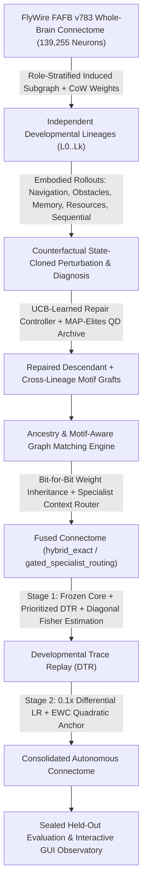
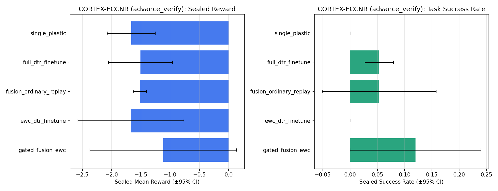
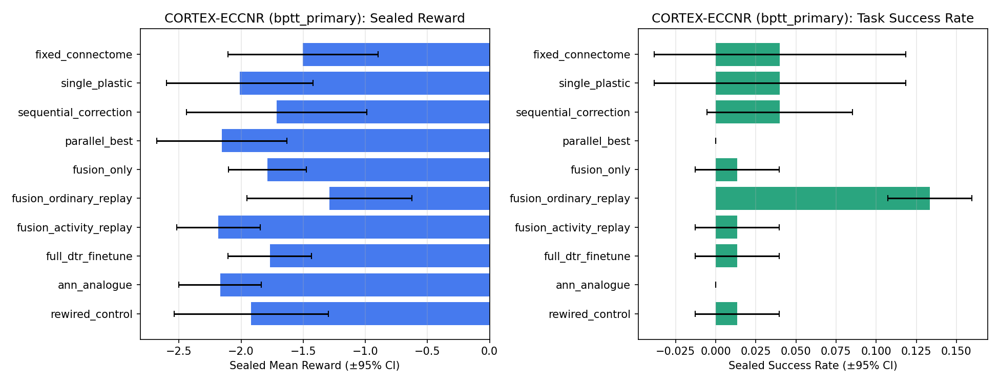

# CORTEX-ECCNR: Evolutionary Connectome Consolidation, Neural Replay & Interactive Observatory

Standalone research platform investigating whether neural agents derived from a verified adult *Drosophila* whole-brain connectome (**FlyWire FAFB v783**, `139,255` proofread neurons, `15,091,983` unique directed edges, `54,492,922` synapses) can collectively acquire, repair, fuse, and consolidate sensorimotor skills across evolutionary lineages better than a single continuously trained brain under strictly matched environment budgets.

## Architecture



## Measured Results Summary

### 1. v0.2.0 Gated-Router + Fisher/EWC Verification (`advance_verify`: 12,000 Matched Steps, Sealed Seeds `9001–9005`)


- **`gated_fusion_ewc`** (4-tap axonal delays + apical-basal dendritic gating + MAP-Elites QD cross-lineage motif exchange + `gated_specialist_routing` exact inheritance + Fisher/EWC consolidation) achieved **`-1.1191 ± 1.2525` sealed reward** and **`12.0%` mean task completion** (up to `20.0%`), outperforming `fusion_ordinary_replay` (`-1.5158`, `5.3%`), `full_dtr_finetune` (`-1.5081`, `5.3%`), and `single_plastic` (`-1.6644`, `0.0%`) while cutting `full_dtr_finetune` prediction error by **`58.9%`**.

### 2. High-Budget 10-Condition Truncated-BPTT Matrix (`bptt_primary`: 24,000 Matched Steps, Sealed Seeds `9001–9005`)


- **`fusion_ordinary_replay`** achieved **`-1.2892 ± 0.6637` sealed reward**, **`13.3% ± 2.6%` task success** (vs `0.0%` for `parallel_best` and `ann_analogue`, `4.0%` for `single_plastic`, and `1.3% ± 2.6%` for `rewired_control`), **`0.0363` prediction error**, and **`51.3×` lower energy proxy** (`42.37` vs `2,175.13`) than the dense ANN analogue.
- Full protocol, negative results at 4,800 steps (`primary`), provenance checksums, limitations, and paper are in [`research/`](research/PAPER.md).

## Interactive GUI Observatory

Launch either as a native desktop window (`pywebview`) or in your browser (`FastAPI` + real-time HTML5 Canvas/SVG):
- **Tab 1 (`Live Arena & Connectome`)**: 2D embodied physics + 45-ray retina visualization, live **W/A/S/D** teleoperation, concentric 256-node FlyWire firing ring graph, click-to-inspect neuron provenance modal, neuromodulator/router meters, and one-click *Neurogenesis*, *Synaptogenesis*, *Prune*, *Perturb & Diagnose*, *Save Checkpoint*, and *Rollback*.
- **Tab 2 (`Lineage DAG & 7-Way Fusion`)**: Run live evolutionary cycles, inspect the SVG Lineage DAG and MAP-Elites QD grid, compare all 7 fusion strategies side-by-side, and promote consolidated brains straight into Tab 1.
- **Tab 3 & Tab 4**: Background benchmark launcher, append-only supervision journal, sortable statistical tables, and Energy-vs-Reward Pareto scatter explorer.

## Quick Commands

```powershell
# 1. Install editable package
pip install -e . --no-deps

# 2. Run full 11-test unit, integration, regression & GUI API suite
pytest tests -v

# 3. Launch Interactive GUI Observatory (Native Desktop Window or Browser)
python scripts/launch_gui.py --desktop
# Or browser mode on http://127.0.0.1:8765 :
python scripts/launch_gui.py

# 4. Acquire & verify FlyWire FAFB v783 whole-brain connectome (stored outside Git in data/flywire)
python scripts/acquire_flywire.py --data-dir data/flywire

# 5. Run experiment suites (smoke | pilot | primary | bptt_primary | advance_verify)
python scripts/run_experiments.py --mode smoke --data-dir data/flywire --out-dir results
python scripts/run_experiments.py --mode advance_verify --data-dir data/flywire --out-dir results
```
